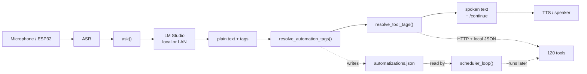

<div align="center">

# Kate · LLM

**The local brain of a 120-tool voice assistant.**

One model. Plain-text tags. No cloud LLM calls.


</div>

> **The model writes the sentence. The tags make it true.**
>
> `ask()` sends the turn to a local model. The model replies in plain text and drops tool tags inline, like `<get_weather; "Prague"/>`. Before anything is spoken, Python replaces those tags with live results. The model never has to *know* today's weather, the news, or the time — it only has to know **how to ask**.

This folder is the LLM layer of [Kate](../README.md): the part between speech recognition and speech synthesis. It owns the conversation, the 120-tool catalog, and the scheduler that runs little workflows later on its own.

---

## Contents

| Start here | Go deeper |
|---|---|
| [Quick start](#quick-start) | [The tag protocol](#the-tag-protocol) |
| [How a turn works](#how-a-turn-works) | [The tool catalog](#the-tool-catalog) |
| [Automations](#automations-a-tiny-n8n) | [Memory and the continue signal](#memory-and-the-continue-signal) |
| [Configuration](#configuration) | [Runtime state](#runtime-state) |
| [Public API](#public-api) | [Extending the catalog](#extending-the-catalog) |
| [Design notes](#design-notes) | [Troubleshooting](#troubleshooting) |

---

## At a glance

| Property | Value |
|---|---|
| **Entry point** | [`main.py`](main.py) → `ask()` |
| **Model** | Any OpenAI-compatible server. Default: [LM Studio](https://lmstudio.ai/) + `qwen3.5-4b` |
| **Endpoint** | The LM Studio URL configured by `LM_URL` in `main.py` — loopback or a LAN host |
| **Tool protocol** | Prompt-driven inline tags — **not** native function calling |
| **Tool catalog** | **120** Python functions returning speech-ready strings |
| **Automation blocks** | Any registered tool; the same catalog powers chat and schedules |
| **Memory** | Last 12 messages (6 exchanges); reset after 10 minutes idle |
| **Dependencies** | `requests`; `psutil` is optional (only for `pc_status`) |

### The three modules

| File | Responsibility |
|---|---|
| [`main.py`](main.py) | One turn: prompt assembly, LM Studio call, streaming, memory, `/continue` |
| [`tools.py`](tools.py) | 120 tool functions, the tool spec catalog, tag parser, timers and personal data |
| [`automatization.py`](automatization.py) | Recurring workflows, trigger parsing, the scheduler and automation tags |

### Why this design is interesting

- **It works with models that cannot call functions.** The tool catalog is rendered into the system prompt as plain text. Any local model that can follow instructions can use it.
- **The model proposes; Python disposes.** Tags are parsed by a forgiving hand-written scanner, not by trusting the model. A malformed or unknown tag is left alone instead of being executed.
- **One catalog powers two features.** Every tool is automatically also an automation block, so a new capability works in chat and in scheduled workflows at the same time.
- **Speech comes first.** Replies are capped at 128 tokens, written to be read aloud, and streamed sentence by sentence while the model is still generating.

---

## Quick start

### 1. Start LM Studio

1. Open [LM Studio](https://lmstudio.ai/) and load a model. The project default is `qwen3.5-4b` for low latency.
2. Start the LM Studio server on port `1234`. If it runs on another computer, set `LM_URL` in `main.py` to that address.
3. Leave the model loaded — Kate connects to it for every turn.

If you use a different model ID, set it in `.env`:

```dotenv
KATE_LLM_MODEL=your/model-id
```

### 2. Install dependencies

From the repository root:

```powershell
python -m venv kate-env
.\kate-env\Scripts\Activate.ps1
pip install -r requirements.txt
```

On Linux or macOS, activate with `source kate-env/bin/activate`.

### 3. Configure

```powershell
Copy-Item example-dotenv .env
```

Add at least a `WEATHER_API_KEY` for current weather. Forecasts, geocoding, air quality and pollen use Open-Meteo and need no key. Every option is listed in [Configuration](#configuration).

### 4. Ask something

```powershell
python LLM/main.py "What's the weather in Prague?"
```

This little entry point calls `ask()` once and prints the reply. It does **not** start the timer or automation loops; those belong to the host app (`Final/main.py` or `ESP/on-pc/server.py`).

### 5. Use it from Python

```python
from LLM.main import ask

print(ask("Give me the top three technology headlines"))
print(ask("Set a timer for 10 minutes"))
```

---

## How a turn works



1. **Assemble the prompt.**
   The system prompt is joined with `tool_prompt()` and `automation_prompt()`, then the last 12 messages are appended. The assistant's previous raw replies stay in history *with their tags*, so the model keeps seeing itself use tools. The result the user actually heard is attached to the latest user turn, so follow-up questions still make sense.

2. **Generate.**
   `_post()` sends the request to LM Studio with `max_tokens: 128`, `reasoning_effort: "none"`, and an optional streaming callback. A reused `requests.Session` keeps the local TCP connection warm between turns.

3. **Strip private thinking.**
   `strip_think()` removes the model's hidden thinking blocks, including incomplete ones from a cut-off generation.

4. **Resolve tags, in a deliberate order.**
   Automations run first, then tools. Tool results come from the internet and are inserted **last**, so a headline can never smuggle in a tag that gets executed, and a tool tag inside an automation definition is not run early.

5. **Guard live data.**
   If the user asked for news, weather, time or another live fact and the model answered without a tag, the reply is probably invented. Kate quietly asks the model once more with a nudge. The user never sees the retry.

6. **Handle the continuation signal and save.**
   `split_continue()` extracts `/continue` from the reply. The raw turn is saved atomically to `memory.json`, and the cleaned reply is returned to the host, marker and all.

### Streaming, with a safety switch

When a host passes `on_sentence`, Kate streams **complete sentences** to TTS while the model is still writing. Streaming is automatically disabled for queries that need fresh data or have side effects — weather, news, timers, reminders, calculations, volume changes, and so on. For those, the full reply is generated and resolved first. That is why a fast voice answer and a correct tool answer can take slightly different paths.

---

## The tag protocol

The model writes ordinary prose and puts a tag exactly where the result belongs:

```text
Right now in Prague it is <get_weather; "Prague"/>. <get_sun_times; "Prague"/>.
```

The user hears something like:

> Right now in Prague it is partly cloudy, 12 degrees Celsius. Sunrise at 6:42 AM and sunset at 6:42 PM, about 12 hours of daylight.

The tag never reaches the speaker.

### Accepted forms

The parser is deliberately forgiving, because small models drift:

| Form | Example |
|---|---|
| Positional | `<get_weather; "Prague"/>` |
| Named arguments | `<get_weather; location="Prague"/>` |
| JSON body | `<get_weather; {"location": "Prague"}/>` |
| No arguments | `<get_time/>` |
| Missing closing slash | `<get_weather; "Prague">` |
| Lower or mixed case name | `<GET_WEATHER; "Prague"/>` |

Unknown tool names and tags that are never closed are **left as text**, not executed. A tool that raises returns a speakable apology instead of crashing the turn.

> The OpenAI-style specs in `tools.py` are not sent as a native `tools` payload. They are the single source of truth used to render the text prompt, which is why any local model can play.

---

## The tool catalog

**120 tools**, grouped by what they are for. Each one returns a short string designed to be spoken, not raw JSON.

<details open>
<summary><b>Time, weather & sky</b> · 17 tools</summary>

| Tool | What it does |
|---|---|
| `get_time` | Current local date and time |
| `get_weather` | Current conditions anywhere (WeatherAPI) |
| `get_forecast` | Seven-day forecast: today, tomorrow, a weekday or the week |
| `rain_check` | Will it rain in the next hours, and when does it start or stop |
| `get_sun_times` | Sunrise, sunset and daylight length |
| `get_air_quality` | Air quality and fine dust |
| `uv_index` | UV index now and today's peak, with sunscreen advice |
| `wind_info` | Current wind speed, gusts and direction |
| `get_pollen` | Tree, grass and weed pollen levels |
| `moon_phase` | Current moon phase and the next full and new moon |
| `world_time` | Local time in up to four places |
| `convert_time` | Translate a clock time between two places |
| `days_until` | Countdown to a date or holiday, plus its weekday |
| `calendar_facts` | Weekday, week number, day of the year and leap year for a date |
| `next_holiday` | Next public holidays for a country |
| `name_day` | Czech name day for today, tomorrow or a date |
| `daily_briefing` | Date, weather, air, sunset, holiday, birthdays, calendar, to-do list and headlines |

</details>

<details>
<summary><b>News & internet</b> · 14 tools</summary>

| Tool | What it does |
|---|---|
| `get_news` | Numbered Google News headlines, worldwide or by topic |
| `news_details` | More about one story from the headlines just read |
| `public_ip` | Your public IP address |
| `website_status` | Whether a site is up, and how fast it answers |
| `ping_host` | Whether a computer, router or server answers, and how fast |
| `github_repo` | Stars, forks, issues and language of a repository |
| `package_info` | Latest PyPI or npm version and summary |
| `get_earthquakes` | Recent notable earthquakes, magnitude 4.5 and up |
| `iss_location` | Where the International Space Station is right now |
| `sports_scores` | Today's scores for leagues or a team |
| `get_stock_price` | Latest stock or index price and daily move |
| `get_crypto_price` | Current cryptocurrency price |
| `convert_currency` | Live exchange-rate conversion |
| `country_info` | Capital, population and currency of a country |

</details>

<details>
<summary><b>Timers & device</b> · 12 tools</summary>

| Tool | What it does |
|---|---|
| `set_timer` | Countdown timer that speaks when it runs out |
| `set_reminder` | Reminder or alarm after a delay or at a clock time |
| `list_timers` | Which timers and reminders are running, and how long is left |
| `cancel_timer` | Cancel one timer or all of them |
| `stopwatch` | Start, check, stop or reset a stopwatch |
| `cook_timer` | Timer with the usual cooking time of a food |
| `set_volume` | Change speaker volume by number or by words like "louder" |
| `get_volume` | Current speaker volume |
| `pc_status` | CPU, memory, disk and battery of the host PC |
| `smart_home` | Home Assistant lights, switches, blinds, locks, scenes and climate |
| `home_status` | State of a smart-home device or sensor |
| `wake_on_lan` | Wake a PC or NAS on the local network |

</details>

<details>
<summary><b>Notes, lists & calendar</b> · 10 tools</summary>

| Tool | What it does |
|---|---|
| `add_note` | Save a note for later |
| `read_notes` | Read or search saved notes |
| `clear_notes` | Delete all, the last, or a numbered note |
| `add_to_list` | Add to the shopping list, to-do list or any named list |
| `read_list` | Read a list aloud |
| `remove_from_list` | Check items off a list |
| `clear_list` | Empty a whole list |
| `add_event` | Put an appointment in the calendar |
| `get_events` | Read today's, tomorrow's or this week's calendar |
| `cancel_event` | Delete an upcoming event |

</details>

<details>
<summary><b>Personal tracking</b> · 9 tools</summary>

| Tool | What it does |
|---|---|
| `log_habit` | Count water, workouts, pages or anything else |
| `habit_stats` | Totals and streaks for counted habits |
| `add_birthday` | Remember someone's birthday |
| `get_birthdays` | When a birthday is, or whose is next |
| `remove_birthday` | Forget a saved birthday |
| `log_expense` | Record money spent |
| `spending_summary` | Totals by period or category |
| `undo_last_expense` | Delete the most recent expense |
| `set_home_location` | Remember the home city used as the default place |

</details>

<details>
<summary><b>Knowledge & language</b> · 13 tools</summary>

| Tool | What it does |
|---|---|
| `define_word` | Dictionary definition of an English word |
| `wiki_summary` | Short encyclopedia summary of a topic |
| `translate` | Translate English into another language |
| `spell_word` | Spell a word letter by letter |
| `morse_code` | Translate text into Morse code or Morse back into text |
| `word_finder` | Synonyms, opposites, rhymes or similar-sounding words |
| `today_in_history` | Events that happened on this day |
| `book_search` | Find a book, its author and what it is about |
| `music_artist` | Facts about an artist or band |
| `anime_info` | Year, episode count, rating and synopsis of an anime |
| `pokemon_info` | Pokédex type, size, abilities and description |
| `random_wikipedia` | Summary of a random Wikipedia article |
| `animal_sound` | An animal sound plus a fun fact |

</details>

<details>
<summary><b>Food, health & fitness</b> · 13 tools</summary>

| Tool | What it does |
|---|---|
| `recipe_search` | Recipe ingredients and steps for a dish |
| `recipe_by_ingredient` | Dishes you can make with an ingredient |
| `cooking_measure` | Convert baking amounts between cups, spoons, grams and ounces |
| `nutrition_info` | Calories, protein, carbs and fat of a food |
| `cocktail_recipe` | Cocktail ingredients and method |
| `bmi` | Body mass index and its category |
| `daily_calories` | Estimated daily calorie needs |
| `heart_rate_zones` | Heart rate training zones from age |
| `water_intake` | How much water to drink a day |
| `pace_calculator` | Running pace and speed from distance and time |
| `quick_workout` | Short bodyweight workout |
| `sleep_calculator` | Bedtime or wake-up time from 90-minute sleep cycles |
| `fuel_cost` | Fuel needed and cost for a trip |

</details>

<details>
<summary><b>Math & money</b> · 16 tools</summary>

| Tool | What it does |
|---|---|
| `calculate` | Arithmetic, percentages, powers and roots via a safe AST evaluator |
| `statistics_summary` | Average, median, total, lowest, highest and spread of a list of numbers |
| `roman_numerals` | Convert a number to Roman numerals or back |
| `number_to_words` | Spell a number in words |
| `base_converter` | Convert numbers between binary, octal, decimal and hexadecimal |
| `convert_units` | Length, weight, volume, speed, area, time, data size and temperature |
| `tip_split` | Tip and bill split between people |
| `date_math` | Date offsets, intervals, age and weekday calculations |
| `distance_between` | Distance between two places and a rough drive time |
| `compare_deals` | Which of two offers is cheaper per unit |
| `loan_payment` | Monthly payment of a loan or mortgage |
| `compound_interest` | What savings grow to over time |
| `vat_calculator` | Add VAT to a price or take it out |
| `discount_calculator` | Price after a percentage discount, or two stacked discounts |
| `electricity_cost` | Running cost of an appliance |
| `hourly_wage` | Convert pay between hourly, weekly, monthly and yearly |

</details>

<details>
<summary><b>Tech & DIY</b> · 4 tools</summary>

| Tool | What it does |
|---|---|
| `password_generator` | Generate a random password or PIN |
| `ohms_law` | Voltage, current, resistance and power from any two of them |
| `paint_calculator` | How much paint a room needs |
| `download_time` | How long a download takes at a given speed |

</details>

<details>
<summary><b>Fun & randomness</b> · 12 tools</summary>

| Tool | What it does |
|---|---|
| `flip_coin` | Heads or tails |
| `roll_dice` | One or more dice, including d20 notation |
| `random_number` | Random number in a range |
| `pick_random` | Choose one of several options |
| `tell_joke` | A joke, optionally by topic |
| `fun_fact` | A random fun fact |
| `magic_8ball` | A yes-or-no answer in 8-ball style |
| `inspire_me` | A short inspiring quote |
| `cat_fact` | A random cat fact |
| `number_fact` | A fact about a number, or a random one |
| `trivia` | Ask a quiz question and check the answer |
| `zodiac_sign` | Star sign and Chinese zodiac animal for a birthday |

</details>

> **Adding your own:** see [Extending the catalog](#extending-the-catalog). The tool prompt and the automation block list are generated from the same `TOOLS` list, so the two features stay in sync.

---

## Automations: a tiny n8n

An automation is a recurring workflow built from tools:

```text
trigger (when)  →  block  →  block  →  spoken output
```

The model creates one by writing a tag. No separate UI, no cron syntax for the user to learn.

```text
<new_automatization; time="10:00, every day"; actions="get_weather=\"Prague\""/>
```

Kate replies with a natural confirmation, and the workflow is stored in `automatizations.json`. When it fires, the **last block's result** is what she says.

### Triggers

| Style | Examples |
|---|---|
| Daily clock time | `10:00, every day`, `every day at 7 AM`, `noon`, `midnight` |
| Weekdays | `on weekdays at 8:30 AM`, `every Monday at 9`, `Mondays and Thursdays at 6 PM` |
| Weekends | `every weekend at 10 AM` |
| Fixed interval | `every 30 minutes`, `every 2 hours`, `hourly`, `every half an hour` |

Automations are recurring by design. One-off reminders and alarms live in `set_timer` and `set_reminder` instead.

### Blocks and pipelines

A block is a tool name plus its arguments. Chain blocks with `;`, `->`, `=>`, `|` or `then`. Use `{{previous}}` in an argument to feed one block's result into the next.

```text
<new_automatization; time="on weekdays at 7:30 AM"; name="Morning brief"; actions="daily_briefing"/>
```

```text
<new_automatization; time="every day at 10 PM"; name="Lights out"; actions='smart_home="living room light", action="off" -> home_status="living room light"'/>
```

The last block's result is what Kate speaks, so the second workflow confirms the light's state after switching it off.

Available tags for managing workflows:

| Goal | Tag |
|---|---|
| Create | `<new_automatization; time="…"; actions="…"/>` — also `create_automatization` and `add_automatization` |
| List | `<list_automatizations/>` — also `show_automatizations` |
| Remove one | `<remove_automatization; name="the news at 7 AM"/>` — also `delete_automatization` and `cancel_automatization` |
| Remove many | `name="all"`, `name="all news"`, `name="all Prague"` |

The `automatization` spelling is the one used by the code and tags. Removal matches names and descriptions fuzzily; if several workflows match equally well, Kate asks which one instead of guessing.

### What can be scheduled

Any registered tool can be written as a block. That flexibility is best used for read-only information tools. Timers, the stopwatch, random one-shots and tools that change personal data are poor fits — they depend on the moment or on a live user.

`set_volume` is a deliberate exception: "every night at 10 PM turn the volume down" is a legitimate automation.

### The scheduler

`Final/main.py` and `ESP/on-pc/server.py` start `scheduler_loop()` in a background thread. It checks every 15 seconds, runs anything due, and hands each result to a callback that speaks it. A `last_run` timestamp prevents the same workflow from firing twice for one scheduled moment.

For bulk deletes, `quick_command()` — used by the ESP host — bypasses the model entirely: "delete all my news automations" is handled deterministically, even if the model is slow or confused.

---

## Memory and the continue signal

### Conversation memory

- The last **12 messages** — six user/assistant exchanges — are sent with every request.
- After **10 minutes** of silence, the next request starts with a clean conversation.
- Memory is stored in `memory.json` at the repository root and written atomically, so a crash cannot leave half a JSON file behind.
- `reset_memory()` clears the in-memory history and deletes the file.

The assistant's history keeps its **raw** replies, tags included, while the text the user actually heard is attached to the latest user message. This lets follow-ups refer to tool results without letting the model forget how it produced them.

### `/continue`

`/continue` is a hidden control signal, not something Kate says. The model writes it on its own last line only when the reply ends with a direct question and the microphone should stay open:

```text
What day should I remind you?
/continue
```

`split_continue()` removes the marker and reports `wants_continue`. The parser also tolerates `[continue]`, `<continue/>`, `(continue)`, a bare `continue`, and infers continuation when the reply ends in `?`. The host decides what to do with that boolean; the LLM only produces it.

---

## Configuration

`tools.py` loads `.env` from the repository root on import, using `python-dotenv` when available and a tiny built-in parser otherwise. Real environment variables win over the file. `.env` is git-ignored; never commit real API keys.

### Model

| Setting | Default | Purpose |
|---|---|---|
| `KATE_LLM_MODEL` | `qwen3.5-4b` | Model ID requested from LM Studio |
| `LM_URL` | set in `main.py` | Endpoint of the LM Studio server — loopback or a LAN address |

The request deliberately uses `max_tokens: 128` and `reasoning_effort: "none"`. Short answers are faster to speak, and skipping hidden reasoning keeps latency down on small local models.

### Integrations

| Variable | Default | Purpose |
|---|---|---|
| `WEATHER_API_KEY` | — | Current weather from WeatherAPI |
| `WEATHER_BASE_URL` | `https://api.weatherapi.com/v1` | WeatherAPI-compatible endpoint |
| `NEWS_BASE_URL` | `https://news.google.com/rss` | News RSS source |
| `HA_URL` | — | Home Assistant base URL |
| `HA_TOKEN` | — | Home Assistant long-lived access token |
| `WOL_DEVICES` | — | Devices for Wake-on-LAN, e.g. `pc=AA:BB:CC:DD:EE:FF,nas=…` |
| `WOL_BROADCAST` | `255.255.255.255` | Wake-on-LAN broadcast address |

Forecasts, geocoding, air quality, pollen and world time use Open-Meteo. Currency uses Frankfurter, crypto uses CoinGecko, and the remaining internet tools use their own public APIs.

### Behavior

| Variable | Default | Purpose |
|---|---|---|
| `DEFAULT_LOCATION` | — | Fallback home city when none has been saved |
| `DEFAULT_COUNTRY` | `CZ` | Fallback country for holidays |
| `DEFAULT_TIP` | `10` | Default tip percentage |
| `DEFAULT_VAT` | `21` | Default VAT percentage |
| `EXPENSE_CURRENCY` | — | Currency label for expenses and fuel cost |
| `BRIEFING_NEWS` | `1` | Set to `0` to leave news out of the daily briefing |
| `DISABLED_TOOLS` | — | Comma-separated extra tool names to hide from the catalog at import time |

### Paths

| Variable | Default | Purpose |
|---|---|---|
| `ENV_FILE` | `<repo>/.env` | Alternative environment file |
| `AUTOMATIONS_FILE` | `<repo>/automatizations.json` | Workflow storage |
| `TIMERS_FILE` | `<repo>/timers.json` | Timers, reminders and stopwatch |
| `DEVICE_STATE_FILE` | `<repo>/device_state.json` | Speaker volume |
| `USER_DATA_FILE` | `<repo>/user_data.json` | Home city, notes, lists, calendar, habits, expenses, birthdays |

---

## Runtime state

Nothing important lives only in RAM. These JSON files sit next to the code at the repository root:

| File | Written by | Contents |
|---|---|---|
| `memory.json` | [`main.py`](main.py) | Recent turns and the last-active timestamp |
| `automatizations.json` | [`automatization.py`](automatization.py) | Triggers, action pipelines, `last_run` |
| `timers.json` | [`tools.py`](tools.py) | Active timers, reminders, alarms and stopwatch |
| `device_state.json` | [`tools.py`](tools.py) | Speaker volume |
| `user_data.json` | [`tools.py`](tools.py) | Home location, notes, lists, calendar, habits, expenses and birthdays |

All of them use a temp-file-plus-replace write, guarded by locks where two threads can touch the same file. They are ignored by git. Delete a file while the app is stopped to reset that store; use `reset_memory()` for the live conversation.

---

## Public API

### Conversation

```python
from LLM.main import ask, reset_memory, split_continue

reply = ask("What's on my calendar today?")
text, keep_listening = split_continue(reply)
```

| Function | Returns | Notes |
|---|---|---|
| `ask(input, system=..., temperature=0.7, on_sentence=None)` | `str` | Runs a whole turn, resolves tags, persists memory |
| `reset_memory()` | `None` | Forgets the conversation in RAM and on disk |
| `split_continue(text)` | `(str, bool)` | Removes `/continue`; `True` means keep listening |
| `strip_think(text)` | `str` | Removes model thinking blocks |

### Tools

| Function | Returns | Notes |
|---|---|---|
| `tool_prompt()` | `str` | Renders the catalog for the system prompt |
| `resolve_tool_tags(text)` | `(str, int)` | Replaces tags; returns the number of calls |
| `call_tool(name, arguments)` | `str` | Calls one tool by name; accepts a dict or JSON |
| `timer_loop(stop_event=None, handler=None, interval=1.0)` | `None` | Fires due timers and reminders |
| `fire_due(now=None)` | `list` | Non-blocking check for due timers |

### Automations

| Function | Returns | Notes |
|---|---|---|
| `scheduler_loop(stop_event=None, handler=None, interval=15.0, path=None)` | `None` | Checks and runs due workflows |
| `run_due(path=None, now=None)` | `list[(automation, result)]` | Non-blocking check |
| `resolve_automation_tags(text, path=None)` | `(str, int)` | Creates, lists or removes workflows from tags |
| `quick_command(text, path=None, last_reply="")` | `str \| None` | Deterministic bulk-removal fast path |
| `create(time_text, actions_text, name="", path=None)` | `(automation, error, is_new)` | Low-level creation |
| `remove_many(identifier, path=None, remove_all=False, count=1)` | `(removed, message)` | Fuzzy removal |

### Host integration

A host needs three things: call `ask()` for chat, split the marker for microphone behavior, and run the two loops so something happens when nobody is talking.

```python
import threading

from LLM.automatization import scheduler_loop
from LLM.main import ask, split_continue
from LLM.tools import timer_loop

# speak() is your TTS or speaker function.
stop = threading.Event()

threading.Thread(
    target=scheduler_loop,
    args=(stop, lambda result, automation: speak(result)),
    daemon=True,
).start()

threading.Thread(
    target=timer_loop,
    args=(stop, lambda message, timer: speak(message)),
    daemon=True,
).start()

reply = ask("Good morning")
text, keep_listening = split_continue(reply)
speak(text)
```

The existing integrations are in [`Final/main.py`](../Final/main.py) for the PC and [`ESP/on-pc/server.py`](../ESP/on-pc/server.py) for the ESP32 bridge.

---

## Extending the catalog

Adding a tool automatically adds it to the chat prompt and makes it available as an automation block.

1. **Write a function** that returns one short, speech-friendly string.

   ```python
   def haiku(topic: str = "") -> str:
       """A tiny poem about a topic."""
       topic = (topic or "the morning").strip()
       return f"Soft rain on the roof. {topic.title()} waits in the quiet. A new day begins."
   ```

2. **Describe it once** with `_tool()` in `_EXTRA_SPECS` (or `TOOLS`):

   ```python
   _tool(
       "haiku",
       "Write a short haiku about a topic. Use for 'write me a haiku about rain'.",
       {"topic": _text("What the poem is about, e.g. 'rain'.")},
       ["topic"],
   ),
   ```

3. **Register the function** in `_EXTRA_FUNCS`:

   ```python
   _EXTRA_FUNCS = {
       # …
       "haiku": haiku,
   }
   ```

4. **Think about schedules.** It is available as a block by default. That suits read-only information tools; avoid scheduling tools that need live input or change personal data.

5. **Test the whole stack.**

   ```powershell
   python LLM/main.py "Write me a haiku about rain"
   ```

Restart the host after changing the catalog: tools and tags are built at import time.

---

## Design notes

- **Prompts are the API.** There is no native function calling and no hidden orchestration framework. The catalog, syntax and examples are plain text, which makes the behavior auditable and portable.
- **The parser is intentionally lenient.** Small models forget closing slashes, switch quote styles and invent spacing. Accepting those variants keeps a 1.7B model usable without weakening execution safety.
- **Internet text is inserted last.** Automation tags are resolved before tool tags, and tool output never gets a second pass. A malicious headline cannot become an executable tag.
- **Errors are speakable.** A failing chat tool becomes a short apology. Weather errors deliberately omit the request URL because it contains the API key.
- **State writes are crash-safe.** Every JSON store writes a temporary file and replaces the original, with locks around stores shared by multiple threads.
- **Private by default.** The conversation goes to the endpoint configured in `LM_URL` — loopback or your own LAN. Only tool arguments (a city, a search term, a package name) leave your network, and only to the service that tool uses.

---

## Troubleshooting

| Symptom | Likely cause | Fix |
|---|---|---|
| `Connection refused` or timeout | LM Studio server is not running at the `LM_URL` address | Start LM Studio, check `LM_URL`, and load the model |
| Model answers "I don't have access to live data" | Wrong model ID or model not loaded | Check `KATE_LLM_MODEL` and the loaded model |
| Tags are read aloud | Tag is malformed, unknown, or never closed | Compare with the accepted forms above; check `DISABLED_TOOLS` |
| Weather says there is no key | `WEATHER_API_KEY` missing | Add it to the root `.env` |
| Forecast works but current weather does not | Forecasts use Open-Meteo; current weather uses WeatherAPI | Add the WeatherAPI key |
| Timers never fire | `timer_loop()` is not running | Start the host app; `python LLM/main.py` does not run loops |
| Automations never fire | `scheduler_loop()` is not running | Start `Final/main.py` or `ESP/on-pc/server.py` |
| Smart home says it is not set up | `HA_URL` or `HA_TOKEN` missing | Add both to `.env` |
| Wake-on-LAN finds no device | `WOL_DEVICES` is empty or malformed | Use `name=AA:BB:CC:DD:EE:FF` pairs separated by commas |
| Streaming callback never fires | Query needs live data or has side effects | Expected; the full reply is returned instead |
| Old conversation keeps coming back | Memory expires after 10 minutes, not immediately | Call `reset_memory()` or delete `memory.json` |
| A disabled extra tool is still offered | `DISABLED_TOOLS` is read at import | Fix the comma-separated names and restart |
| A schedule fires late | Scheduling is checked every 15 seconds and runs when due | Normal; timers themselves poll every second |

---

## Related

- [Project README](../README.md) — the full ASR → LLM → TTS → ESP32 pipeline
- [PC host](../Final/main.py) — streaming speech and barge-in
- [ESP32 bridge](../ESP/on-pc/server.py) — the FastAPI server for the device
- [Requirements](../requirements.txt) — Python dependencies
- [Example environment](../example-dotenv) — copy to `.env`

## License

MIT. See [LICENSE](../LICENSE).
