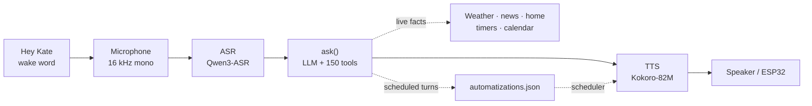
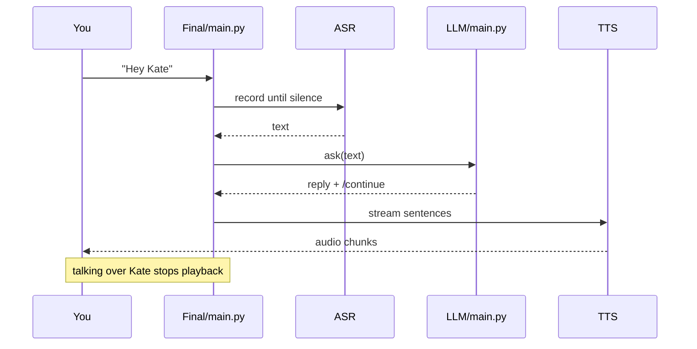

<div align="center">

# Kate

**A local voice assistant that fits on your desk — and in your hand.**

Wake word → speech in → local brain → speech out.

<p align="center">
  
</p>


</div>

> **Two entry points, one pipeline.**
>
> [`Final/main.py`](Final/main.py) runs Kate on a PC with a microphone and speakers. [`ESP/on-pc/server.py`](ESP/on-pc/server.py) puts the same ASR → LLM → TTS pipeline behind a small FastAPI bridge for the ESP32. The device runs the wake word, captures audio and plays the reply; the thinking stays on the PC.

This is the repository around [the LLM layer](LLM/README.md): a wake-word assistant that listens locally, thinks locally, speaks locally, and reaches the internet only when a tool needs a live fact. Work in progress — **150 of 500 planned tools** are in place.

---

## Contents

| Start here | Go deeper |
|---|---|
| [Quick start](#quick-start) | [How a turn works](#how-a-turn-works) |
| [Architecture](#architecture) | [The ESP32 bridge](#the-esp32-bridge) |
| [Configuration](#configuration) | [Wake word and barge-in](#wake-word-and-barge-in) |
| [Models and latency](#models-and-latency) | [Runtime state](#runtime-state) |
| [Public API](#public-api) | [Troubleshooting](#troubleshooting) |

---

## At a glance

| Property | Value |
|---|---|
| **Entry points** | [`Final/main.py`](Final/main.py) · [`ESP/on-pc/server.py`](ESP/on-pc/server.py) |
| **Wake word** | "Hey Kate" — microWakeWord; TFLite Micro on the ESP32, `pymicro-wakeword` on the PC |
| **ASR** | Qwen3-ASR `Qwen3-ASR-0.6B`, 16 kHz mono |
| **LLM** | Any OpenAI-compatible server. Default: [LM Studio](https://lmstudio.ai/) + `qwen3.5-4b` |
| **TTS** | Kokoro-82M, voice `af_heart`, 24 kHz mono |
| **Tools** | **150** speech-ready Python functions with inline tags — [catalog](LLM/README.md#the-tool-catalog) |
| **Memory** | Last 12 messages (6 exchanges); reset after 10 minutes idle |
| **Latency** | ~1 s on an RTX 4060; ~0.8 s on ESP32; best runs around 0.65 s |
| **Hardware** | 8 GB VRAM recommended; more for larger LLMs |
| **Dependencies** | [`requirements.txt`](requirements.txt); LM Studio runs separately |

### The modules

| File | Responsibility |
|---|---|
| [`Final/main.py`](Final/main.py) | PC host: wake word, recording, barge-in, streaming playback, automation scheduler |
| [`ESP/on-pc/server.py`](ESP/on-pc/server.py) | FastAPI bridge: streamed WAV replies, long-poll announcements, timers, volume headers |
| [`ESP/on-esp/voice_assistant.ino`](ESP/on-esp/voice_assistant.ino) | ESP32 sketch: wake word, mic capture, HTTP upload and audio playback |
| [`ASR/main.py`](ASR/main.py) | Qwen3-ASR model, transcription and startup warmup |
| [`ASR/record.py`](ASR/record.py) | Microphone capture, noise calibration, end-of-speech detection, barge-in detector |
| [`TTS/main.py`](TTS/main.py) | Kokoro-82M streaming synthesis, sentence splitting and text cleanup |
| [`LLM/main.py`](LLM/main.py) | One conversation turn: prompt, LM Studio call, tag resolution, memory |
| [`LLM/tools.py`](LLM/tools.py) | 150 tools, parser, timers and personal data |
| [`LLM/automatization.py`](LLM/automatization.py) | Recurring workflows, triggers and the scheduler |
| [`Hey_Kate/listen_kate.py`](Hey_Kate/listen_kate.py) | Desktop "Hey Kate" wake word using the same model as the ESP32 |

### Why this design is interesting

- **Everything that can stream, streams.** The LLM emits sentences as they are generated, and Kokoro starts speaking the first short chunk while the rest is still being synthesized. Tempo, not just raw model speed, is what makes the assistant feel quick.
- **The PC does the thinking; the ESP32 stays thin.** The sketch runs only the wake word, audio capture and playback. The heavy models live on the PC, so a cheap microcontroller gets the same brain as the desktop app.
- **Barge-in is part of the host, not the model.** A separate microphone watcher cuts playback the moment you talk over Kate, with a short deaf window so she cannot interrupt herself.
- **The wake word is the same everywhere.** `hey_kate.tflite` runs under TensorFlow Lite Micro on the device and through `pymicro-wakeword` on the PC, so detections behave the same on both paths.
- **Local by default.** Speech recognition, reasoning and speech synthesis never leave your machine. Only tool arguments — a city, a search term, a package name — go out, and only to the service that tool uses.

---

## Architecture



The pipeline has four models or services, and each one is replaceable:

1. **Wake word** — a small TFLite model watches 16 kHz audio and opens the microphone.
2. **ASR** — Qwen3-ASR turns the finished utterance into text. End-of-speech detection lives in `ASR/record.py`, so the recognizer does not need a second VAD pass.
3. **LLM** — [`ask()`](LLM/main.py) sends the conversation to LM Studio, resolves automation and tool tags, and returns a short spoken reply.
4. **TTS** — Kokoro-82M synthesizes the reply in chunks. Playback begins with the first chunk.

The LLM is the only stage that depends on a separate server: it expects an OpenAI-compatible endpoint, normally LM Studio on the same machine or the LAN. The tools inside it are ordinary Python functions, documented in the [LLM README](LLM/README.md).

---

## Quick start

### 1. Create the environment

Python 3.12 is what the project is developed against.

```powershell
python -m venv kate-env
.\kate-env\Scripts\Activate.ps1
```

On Linux or macOS, activate with `source kate-env/bin/activate`.

### 2. Install the dependencies

```powershell
pip install -r requirements.txt
```

On a Windows PC with an NVIDIA GPU, replace PyTorch with the matching CUDA build so ASR and TTS can use the GPU. For CUDA 12.8:

```powershell
python -m pip install --upgrade torch==2.11.0+cu128 --index-url https://download.pytorch.org/whl/cu128
```

PyTorch's [official installer](https://pytorch.org/get-started/locally/) lists the available CUDA builds. Kate falls back to CPU when CUDA is unavailable; Kokoro prints a warning.

The first run downloads the Qwen3-ASR and Kokoro weights (a few hundred MB, cached afterwards in the Hugging Face cache). Startup also warms both models so the first real question is not the slow one.

### 3. Start LM Studio

1. Open [LM Studio](https://lmstudio.ai/) and load a model. The project default is `qwen3.5-4b` for low latency.
2. Start the local server on port `1234`.
3. Leave the model loaded — Kate connects for every turn.

If LM Studio runs on another computer, point `LM_URL` in `.env` at that machine. If you load a different model, set `KATE_LLM_MODEL` to its ID.

### 4. Configure

```powershell
Copy-Item example-dotenv .env
```

At minimum, add a `WEATHER_API_KEY` for current weather. The full set of pipeline and tool settings is in [Configuration](#configuration).

### 5. Run Kate on the PC

```powershell
python .\Final\main.py
```

Stay quiet for the ambient-noise calibration. Kate warms up speech recognition and the voice, greets you, and then waits for **"Hey Kate"**. Speak normally and stop when you are done — the recorder detects the pause.

### 6. Run Kate on the ESP32

1. Open [`ESP/on-esp/voice_assistant.ino`](ESP/on-esp/voice_assistant.ino) and set `WIFI_SSID`, `WIFI_PASS` and `SERVER_HOST` (the PC's LAN address).
2. Set `HAVE_SPEAKER` to `1` once the MAX98357A is wired.
3. Flash the sketch. It needs the Arduino-ESP32 core **2.0.x** and a TensorFlow Lite Micro library with the microfrontend.
4. Start the bridge on the PC:

   ```powershell
   python .\ESP\on-pc\server.py
   ```

5. Allow Python through the Windows firewall on private networks, or the ESP32 cannot connect.

The bridge listens on `0.0.0.0:8000`. The same pipeline can be started with `uvicorn server:app --host 0.0.0.0 --port 8000` from `ESP\on-pc`.

### 7. Try the brain without a microphone

```powershell
python LLM/main.py "What's the weather in Prague?"
```

This calls `ask()` once and prints the reply. It does **not** start the wake word, timers or automations; those belong to the host apps.

### 8. Optional: a one-click server

Copy [`example-serverdotbat`](example-serverdotbat) to `server.bat`, edit `VENV` and `ESP_DIR`, and use it to activate the environment and start the ESP bridge. A desktop shortcut to that file is the usual setup.

---

## How a turn works

### The PC path



1. **Wait for the wake word.**
   `wait_for_wake_word()` feeds 80 ms blocks to the microWakeWord model. A detection prints the certainty and returns; every conversation starts with the wake word, while the recent history stays available to the model.

2. **Record until the user stops.**
   `record_wav()` calibrates the room once, keeps 0.3 s of pre-roll so the first word is not clipped, and ends after 0.35 s of silence. A single recording is capped at 15 s, and 10 s of silence before speech cancels the turn.

3. **Transcribe.**
   Qwen3-ASR runs at 16 kHz with beam search, no timestamps and no VAD filter. `get_speech_end_time()` records the moment the user stopped talking, which is the zero point for the latency line.

4. **Think, with tools.**
   `ask()` assembles the system prompt, the 150-tool catalog and the recent conversation. The model replies in plain text with inline tags such as `<get_weather; "Prague"/>`; Python replaces those tags before anything is spoken. Live-data questions that produce no tag get one quiet retry.

5. **Speak while the model is still writing.**
   `on_sentence` hands complete, safe sentences to Kokoro as they arrive. Chunks of up to 30 words are synthesized in the background, and the first chunk is deliberately kept short so playback starts sooner. The full reply is also written to `output_custom_voice.wav`.

6. **Handle interruptions and commands.**
   While Kate speaks, `InterruptDetector` watches the microphone. If you talk over her, playback stops and the next turn starts without the wake word. Phrases like "stop", "repeat that" and "forget everything" are handled by the host before the model is called.

7. **Log and measure.**
   Both sides of the conversation are appended to `conversation_log.txt`, and each turn prints a line such as:

   ```text
   Latency: ASR 0.38s | LLM complete 0.28s | first audio after ASR 0.24s | total 0.61s
   ```

   "LLM complete" is the whole model turn; "first audio after ASR" is what you actually feel.

### The ESP32 path

The device is a thin client, but not a dumb one:

- The wake word runs on the ESP32. Only after a detection does it start streaming 16 kHz 16-bit mono PCM to `POST /talk`.
- The upload connection is opened **before** the wake word fires, so recording can begin without waiting for a TCP handshake.
- The server transcribes, thinks and synthesizes, then answers with a WAV stream at Kokoro's 24 kHz rate. The ESP plays it while it is still arriving.
- Reply headers carry `X-Continue`, `X-Volume` and `X-Latency`. If `X-Continue` is `1`, the ESP listens again without requiring the wake word.
- A second connection is held open on `GET /announce`. Timers, reminders and scheduled workflows are pushed through it, with a chime first where appropriate. If nothing happens, the server returns `204` after the requested wait as a heartbeat, and the device reconnects.

There is no barge-in on the ESP32 path: the sketch blocks while it plays the reply. The PC host can watch the microphone while its output stream is running.

### Command phrases

Both hosts handle these before calling the model, so they work even when the LLM is slow:

| Say | What happens |
|---|---|
| "forget everything", "forget our conversation", "clear your memory", "reset your memory" | Conversation is cleared in RAM and on disk |
| "stop", "stop talking", "be quiet", "shut up", "hush", "never mind", "that is enough" | The utterance is dropped |
| "repeat that", "say that again", "say it again", "come again", "what did you say", "pardon" | Kate repeats her previous reply |
| "goodbye", "bye", "good night", "shut down", "quit" | Kate says goodbye and the PC host exits |

The ESP bridge also routes bulk automation removal through `quick_command()`, so "delete all my news automations" never depends on the model writing the right tag.

---

## The ESP32 bridge

### HTTP surface

| Endpoint | Method | Purpose |
|---|---|---|
| `/talk` | `POST` | Chunked 16 kHz mono PCM in; streamed WAV out. `204` means there is nothing to say. |
| `/announce?wait=300` | `GET` | Long poll for timers, reminders and automations; `204` after the wait acts as a heartbeat. |
| `/last.wav` | `GET` | Download the newest saved prompt. |
| `/recordings` | `GET` | A page listing every saved prompt, with inline players. |
| `/recordings/{name}` | `GET` | One saved prompt. |

### Reply headers

| Header | Meaning |
|---|---|
| `X-Continue: 1` | Kate asked a question; listen again without the wake word |
| `X-Volume: 0..100` | Speaker volume the user asked for; applied before playback |
| `X-Latency: …` | The same ASR / LLM / first-audio / total line printed on the PC, shown in the ESP32 Serial Monitor |

The first TTS chunk is synthesized **before** the response headers are sent. That way the response starts with audio that is ready and the complete latency line can travel with it. `X-Volume` and `X-Continue` are sent on every reply, with or without audio.

### Timers, reminders and announcements

`ESP/on-pc/server.py` starts both background loops:

- `scheduler_loop()` runs recurring automations and pushes the result to the long poll.
- `timer_loop()` fires timers, reminders and alarms and rings the chime first.

The chime is generated locally — a soft two-tone ding-dong repeated three times — and prepended to the spoken announcement. Set `CHIME_REPEATS = 0` in the server if you want silence first.

### Diagnostics

Recording is off by default because it costs latency:

| Setting | Default | Effect |
|---|---|---|
| `KATE_SAVE_RECORDINGS` | `0` | Save every prompt as `esp_recordings/prompt_*.wav`; enables `/last.wav` and `/recordings` |
| `KATE_SAVE_DEBUG_WAV` | `0` | Save the normalized ASR input as `esp_last_recording.wav` |

Both are read from `.env` when the server starts. The ESP32 side prints noise floor, wake-word probability and the latency line to the Serial Monitor at 115200 baud.

---

## Wake word and barge-in

### "Hey Kate"

The wake-word model lives in [`Hey_Kate/`](Hey_Kate): `hey_kate.tflite`, its config in `hey_kate.json`, and a C array in `hey_kate_model.h` for the sketch. The same model is used on both sides.

| Setting | Value | Notes |
|---|---|---|
| Sample rate | 16 kHz | Mono, 16-bit |
| `WAKE_CUTOFF` | `0.97` | Detection probability cutoff |
| `WAKE_WINDOW` | `5` | Inferences averaged before a detection |
| `WAKE_COOLDOWN_MS` | `1500` | Ignore repeat detections after playback |

On the PC, [`Hey_Kate/listen_kate.py`](Hey_Kate/listen_kate.py) wraps the model with `pymicro-wakeword` and feeds it 80 ms blocks. On the ESP32, the sketch uses TensorFlow Lite Micro and the same audio frontend, so the two paths see the same features.

### Barge-in

The PC host sets `BARGE_IN = True` in [`Final/main.py`](Final/main.py). While Kate speaks, `InterruptDetector` watches for speech that clearly beats the ambient threshold:

| Constant | Default | Purpose |
|---|---|---|
| `INTERRUPT_GAIN` | `2.0` | Mic level must beat ambient noise by this much |
| `INTERRUPT_MIN_SECONDS` | `0.35` | Continuous speech needed before playback stops |
| `INTERRUPT_IGNORE` | `0.5` | Deaf window at playback start, so Kate cannot trigger herself |

If Kate cuts herself off too easily, raise `INTERRUPT_GAIN` or `INTERRUPT_MIN_SECONDS`. If she triggers on her own first syllable, raise `INTERRUPT_IGNORE`.

---

## Models and latency

| Stage | Default | Main knob |
|---|---|---|
| Wake word | microWakeWord "Hey Kate" | `WAKE_CUTOFF`, `WAKE_WINDOW` |
| ASR | Qwen3-ASR `Qwen3-ASR` | `KATE_ASR_MODEL`, `KATE_ASR_DEVICE`, `KATE_ASR_COMPUTE_TYPE` |
| LLM | `qwen3.5-4b` on LM Studio | `KATE_LLM_MODEL`, `LM_URL` |
| TTS | Kokoro-82M, `af_heart`, 24 kHz | `VOICE`, `SPEED`, `LANG_CODE` |

On an NVIDIA RTX 4060, `Final/main.py` currently reaches about **1 second** end to end, with the best runs around **0.65 seconds**. The ESP32 path is around **0.8 seconds**, with lows near **0.65 seconds**. Targets are the same numbers; optimization is ongoing, and the time depends heavily on the LLM being used. `qwen3-1.7b` produced the fastest run.

### Speech recognition

The code defaults to `KATE_ASR_MODEL=Qwen3-ASR`.

### Speech synthesis

Kokoro runs in-process: no HTTP server, no API key. Its first synthesis compiles GPU kernels, so `warmup()` is called at startup rather than during the first real answer. The streaming path:

- splits on sentence boundaries, then on clause breaks for long sentences;
- merges short sentences up to 30 words;
- keeps the first chunk at roughly 7 words so playback starts sooner;
- prefetches the next chunk while the current one plays;
- trims leading and trailing silence and applies a 5 ms fade to avoid clicks;
- stops early when barge-in fires and cancels the remaining chunks.

If CUDA is not available, Kokoro warns and runs on the CPU — correct, but noticeably slower.

---

## Configuration

`LLM/tools.py` loads `.env` from the repository root on import, using `python-dotenv` when available and a small built-in parser otherwise. Real environment variables win over the file. `.env` is git-ignored; never commit real API keys.

[`example-dotenv`](example-dotenv) contains the minimum:

```dotenv
WEATHER_API_KEY=...
WEATHER_BASE_URL=https://api.weatherapi.com/v1
NEWS_BASE_URL=https://news.google.com/rss
LM_URL=http://localhost:1234/v1/chat/completions
```

### Pipeline settings

| Variable | Default | Used by | Purpose |
|---|---|---|---|
| `LM_URL` | `http://localhost:1234/v1/chat/completions` | `LLM/main.py` | LM Studio endpoint, loopback or LAN |
| `KATE_LLM_MODEL` | `qwen3.5-4b` | `LLM/main.py` | Model ID requested from LM Studio |
| `KATE_ASR_MODEL` | `Qwen3-ASR` | `ASR/main.py` | Any Qwen-ASR model name |
| `KATE_ASR_DEVICE` | auto | `ASR/main.py` | `cuda:0` or `cpu` |
| `KATE_ASR_COMPUTE_TYPE` | `float16` / `int8` | `ASR/main.py` | `float16` on CUDA, `int8` on CPU |
| `KATE_SAVE_RECORDINGS` | `0` | ESP bridge | Keep every ESP prompt as a WAV |
| `KATE_SAVE_DEBUG_WAV` | `0` | ESP bridge | Keep the normalized ASR input |
| `WEATHER_API_KEY` | — | Weather tools | Current weather from WeatherAPI |
| `WEATHER_BASE_URL` | `https://api.weatherapi.com/v1` | Weather tools | WeatherAPI-compatible endpoint |
| `NEWS_BASE_URL` | `https://news.google.com/rss` | News tools | RSS source |

### Tool settings

The tools add their own variables — Home Assistant (`HA_URL`, `HA_TOKEN`), Wake-on-LAN (`WOL_DEVICES`, `WOL_BROADCAST`), defaults (`DEFAULT_LOCATION`, `DEFAULT_COUNTRY`, `DEFAULT_TIP`, `DEFAULT_VAT`, `EXPENSE_CURRENCY`), the briefing switch, disabled tools and the runtime file paths. They are documented in the [LLM README configuration section](LLM/README.md#configuration).

### ESP32 sketch constants

| Constant | Default | Change it to |
|---|---|---|
| `WIFI_SSID`, `WIFI_PASS` | empty | Your Wi-Fi network |
| `SERVER_HOST` | empty | The PC's LAN address |
| `SERVER_PORT` | `8000` | Match the bridge |
| `HAVE_SPEAKER` | `0` | `1` once the MAX98357A is wired |
| `MIC_GAIN` | `36.0` | Raise for a quiet mic, lower if distorted |
| `WAKE_CUTOFF` | `0.97` | Match `probability_cutoff` in `hey_kate.json` |
| `WAKE_WINDOW` | `5` | Match `sliding_window_size` in `hey_kate.json` |
| `SERVER_CHECK_MS` | `300000` | How often the announcement poll heartbeats |
| `RETRY_MS` | `30000` | How long to wait before retrying a missing server |
| `volume` | `40` | Initial software volume, 0–100; the server overrides it on every reply |

### Wiring

| Part | Pin | ESP32 |
|---|---|---|
| MAX4466 microphone | OUT | GPIO32 |
| MAX4466 microphone | VCC / GND | 3.3 V / GND |
| MAX98357A amplifier | BCLK | GPIO26 |
| MAX98357A amplifier | LRC | GPIO25 |
| MAX98357A amplifier | DIN | GPIO22 |
| MAX98357A amplifier | VIN / GND | 5 V / GND |

The ESP32 sketch requires the Arduino-ESP32 core **2.0.x** — built-in I2S ADC mode is gone in 3.x — and a TensorFlow Lite Micro library recent enough for the model's ops and the microfrontend.

### Bridge constants

| Constant | Default | Purpose |
|---|---|---|
| `MIN_AUDIO_SECONDS` | `0.3` | Shorter uploads are treated as "nothing heard" |
| `NORMALIZE` | `True` | Scale quiet analog-mic input before ASR |
| `TARGET_PEAK` | `0.7` | Normalization target |
| `MAX_GAIN` | `20.0` | Maximum normalization gain |
| `HEAD_PAD_SECONDS` | `0.15` | Silence before the first word so the amp does not clip it |
| `CHIME_REPEATS` | `3` | Timer chime repetitions; `0` disables it |

---

## Runtime state

Nothing important lives only in RAM. These files sit at the repository root and are ignored by git:

| File | Written by | Contents |
|---|---|---|
| `memory.json` | `LLM/main.py` | Recent turns and the last-active timestamp |
| `automatizations.json` | `LLM/automatization.py` | Triggers, action pipelines and `last_run` |
| `timers.json` | `LLM/tools.py` | Active timers, reminders, alarms and stopwatch |
| `device_state.json` | `LLM/tools.py` | Speaker volume |
| `user_data.json` | `LLM/tools.py` | Home city, notes, lists, calendar, habits, expenses and birthdays |
| `conversation_log.txt` | PC host and ESP bridge | Timestamped transcript of both sides |
| `output_custom_voice.wav` | PC host | The last reply, as played |
| `esp_last_recording.wav` | ESP bridge | Last normalized ASR input, when debugging is on |
| `esp_recordings/` | ESP bridge | Saved prompts, when `KATE_SAVE_RECORDINGS=1` |

The JSON stores use a temp-file-plus-replace write, with locks around files that two threads can touch. The log is append-only. Delete a store while the app is stopped to reset it; use `reset_memory()` to clear the live conversation.

---

## Public API

The pipeline is importable, not just runnable. The full LLM surface — `ask`, `reset_memory`, `split_continue`, `tool_prompt`, `resolve_tool_tags`, `scheduler_loop`, `run_due`, `quick_command` and friends — is documented in the [LLM README](LLM/README.md#public-api).

### Speech and wake word

| Function | Returns | Notes |
|---|---|---|
| `ASR.main.asr()` | `str` | Records from the microphone, transcribes and returns text |
| `ASR.main.warmup()` | `None` | Pays the first-inference cost at startup |
| `ASR.main.model.transcribe(audio, language)` | list | Qwen-shaped adapter used by the ESP bridge |
| `ASR.record.record_wav()` | `bytes` | Complete WAV bytes; nothing is written to disk |
| `ASR.record.calibrate()` | `float` | Measures ambient noise once and caches the threshold |
| `ASR.record.InterruptDetector` | context manager | Sets `event` when the user talks over playback |
| `TTS.main.synthesize(text)` | `bytes` | Whole reply as WAV bytes |
| `TTS.main.stream_generate_audio(text, stop=None)` | generator | `(audio, sample_rate)` per chunk |
| `TTS.main.clean_text(text)` | `str` | Removes markdown before speaking |
| `TTS.main.split_text(text)` | `list[str]` | The chunks the streamer will use |
| `TTS.main.warmup()` | `None` | Compiles GPU kernels before the first reply |
| `Hey_Kate.listen_kate.load_model(config)` | `(model, features)` | Loads the TFLite wake word |
| `Hey_Kate.listen_kate.feed(model, features, chunk)` | `(bool, float)` | Feed 80 ms of audio; returns fired and certainty |

### Host integration

A host needs three things: wake the microphone, call `ask()`, and run the background loops so something happens when nobody is talking.

```python
import threading

from LLM.automatization import scheduler_loop
from LLM.main import ask, split_continue
from LLM.tools import timer_loop

# speak() is your TTS or speaker function.
stop = threading.Event()

threading.Thread(
    target=scheduler_loop,
    args=(stop, lambda result, automation: speak(result)),
    daemon=True,
).start()

threading.Thread(
    target=timer_loop,
    args=(stop, lambda message, timer: speak(message)),
    daemon=True,
).start()

reply = ask("Good morning")
text, keep_listening = split_continue(reply)
speak(text)
```

The two working integrations are [`Final/main.py`](Final/main.py) for the PC and [`ESP/on-pc/server.py`](ESP/on-pc/server.py) for the device bridge. `python LLM/main.py "…"` is only a one-shot text entry point: it starts no loops and no microphone.

---

## Extending Kate

### Change the voice

Edit `VOICE`, `SPEED` or `LANG_CODE` in [`TTS/main.py`](TTS/main.py). `af_heart` is an American English voice; `LANG_CODE = "b"` selects British English for the matching voices. Kokoro's voice list is in its own documentation.

### Change the models

- **ASR:** set `KATE_ASR_MODEL` in `.env` (`small.en`, `base.en`, or a larger multilingual model).
- **LLM:** set `KATE_LLM_MODEL` and `LM_URL`.
- **TTS:** edit the Kokoro constants above.

### Add a tool

Adding a tool automatically adds it to the chat prompt and makes it available as an automation block. The step-by-step recipe — function, `_tool()` spec, `_EXTRA_FUNCS` registration and a test — is in the [LLM README](LLM/README.md#extending-the-catalog). Restart the host afterwards: the catalog is built at import time.

### Teach a new wake word

Replace `hey_kate.tflite` and `hey_kate.json` in [`Hey_Kate/`](Hey_Kate), regenerate `hey_kate_model.h` (the `.tflite` as a C array) and put it in `ESP/on-esp/`, then update `WAKE_CUTOFF` / `WAKE_WINDOW` to match the new config. The PC and ESP32 then share the new model.

### Write another host

Any host only needs the public functions above. The ESP bridge is a good template for a network host: it keeps JSON state out of the HTTP handlers, runs ASR and LLM one request at a time, and turns long-running work into threads with callbacks.

---

## Design notes

- **Latency is a pipeline property.** The LLM caps replies at 128 tokens, skips hidden reasoning, streams sentences and lets TTS start early. The first spoken chunk is shorter than the rest on purpose.
- **Endpointing happens before recognition.** `record.py` decides when the user stopped talking; Qwen3-ASR runs without a second VAD pass. That keeps the ASR call simple and the turn boundary predictable.
- **The ESP32 is a thin client with a local trigger.** The wake word must run on the device, or the microphone would have to stream continuously. Everything after that is server work.
- **Connections are kept warm.** The PC reuses a `requests.Session` for LM Studio, keeps its PortAudio output stream open, and the ESP32 opens its upload connection before the wake word fires. Startup cost is moved out of the conversation.
- **Announcements are pushed, not polled.** The long poll means a timer or automation reaches the device immediately, while a heartbeat keeps the link honest when nothing happens.
- **The ESP bridge is allowed to bypass the model.** Bulk automation removal uses `quick_command()`, because a deterministic request should not depend on a small local model getting a tag exactly right.
- **Failures are spoken, not crashed.** A failed tool returns a short apology; a failed LLM turn is replaced with "Sorry, something went wrong on my side." The ESP gets `204` when there is nothing to say.
- **Private by default.** The conversation stays on the machine or the LAN. Only tool arguments leave the network.

---

## Troubleshooting

| Symptom | Likely cause | Fix |
|---|---|---|
| `Connection refused` or timeout | LM Studio is not running at `LM_URL` | Start LM Studio, check `LM_URL`, load the model |
| Model answers "I don't have access to live data" | Wrong model ID or model not loaded | Check `KATE_LLM_MODEL` and the loaded model |
| Wake word never fires | Mic muted, wrong input device, or model config mismatch | Check the input device and mic level; confirm the `.tflite` and JSON match |
| Wake word fires constantly | Room noise or a cutoff that is too low | Raise `WAKE_CUTOFF`, reduce `MIC_GAIN`, check `hey_kate.json` |
| ASR hears nothing | Calibration threshold too high or mic too quiet | Restart and stay quiet during calibration; raise the mic level |
| ASR is slow | Model too large or running on CPU | Use `small.en`/`base.en`, check `KATE_ASR_DEVICE`, install the CUDA PyTorch build |
| "CUDA not available" warning from Kokoro | PyTorch has no CUDA build, or the driver is missing | Install the matching `torch` CUDA wheel |
| TTS is slow or choppy | CPU synthesis, or the first run is still warming up | Check the warning, run `python TTS/main.py`, keep the first reply short |
| Kate cuts herself off | Barge-in threshold too sensitive | Raise `INTERRUPT_GAIN` or `INTERRUPT_MIN_SECONDS` |
| Kate ignores barge-in | Threshold too high or the pause too long | Lower `INTERRUPT_GAIN` / `INTERRUPT_MIN_SECONDS` |
| Tags are read aloud | Tag malformed, unknown or never closed | See the [tag protocol](LLM/README.md#the-tag-protocol); check `DISABLED_TOOLS` |
| Weather says there is no key | `WEATHER_API_KEY` missing | Add it to `.env` |
| Timers never fire | `timer_loop()` is not running | Run `ESP/on-pc/server.py` (it starts the loop); the PC-only host starts only `scheduler_loop()` |
| Automations never fire | `scheduler_loop()` is not running | Run `Final/main.py` or `ESP/on-pc/server.py` |
| ESP32 cannot connect | Wrong `SERVER_HOST`, firewall, or different network | Set the PC's LAN IP, allow Python on private networks, check port `8000` |
| ESP32 has no audio | `HAVE_SPEAKER` still `0`, or the amp is not wired | Set `HAVE_SPEAKER` to `1`, check BCLK/LRC/DIN and 5 V power |
| ESP32 audio is quiet | Software volume too low | Say "louder" or set `volume` in the sketch; the server owns the value |
| `/last.wav` returns 404 | No prompt has been saved | Set `KATE_SAVE_RECORDINGS=1` and talk to the device once |
| A schedule fires late | Scheduling is checked every 15 seconds | Normal; timers poll every second |
| Old conversation keeps coming back | Memory expires after 10 minutes, not immediately | Say "forget everything" or call `reset_memory()` |
| `server.bat` opens the wrong environment | Paths are machine-specific | Edit `VENV` and `ESP_DIR` from [`example-serverdotbat`](example-serverdotbat) |

---

## Related

- [LLM README](LLM/README.md) — the brain: tag protocol, 150-tool catalog, automations, memory and configuration
- [PC host](Final/main.py) — wake word, streaming speech and barge-in
- [ESP32 bridge](ESP/on-pc/server.py) — FastAPI server for the device
- [ESP32 sketch](ESP/on-esp/voice_assistant.ino) — wake word, microphone and playback firmware
- [ASR](ASR/main.py) and [recording](ASR/record.py) — recognition and endpointing
- [TTS](TTS/main.py) — Kokoro streaming synthesis
- [Wake word](Hey_Kate/listen_kate.py) — desktop implementation of "Hey Kate"
- [Requirements](requirements.txt) — Python dependencies
- [Example environment](example-dotenv) — copy to `.env`

## License

MIT. See [LICENSE](LICENSE).
